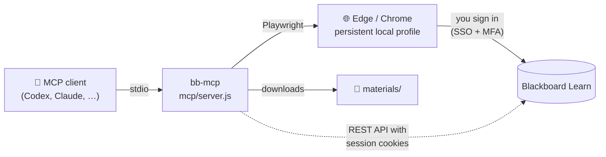

<div align="center">

# 🎓 Blackboard MCP

**Let your AI assistant browse Blackboard Learn for you — with your own login, in your own browser.**

[](https://github.com/UKplus8HRS/bb-mcp/actions/workflows/test.yml)
[](LICENSE)
[](https://nodejs.org/)
[](https://modelcontextprotocol.io/)
[](https://playwright.dev/)

[Quick start](#-quick-start) ·
[Tools](#-tools) ·
[Configuration](#%EF%B8%8F-configuration) ·
[Privacy & safety](#-privacy--safety) ·
[Troubleshooting](#-troubleshooting)

</div>

---

A local [Model Context Protocol](https://modelcontextprotocol.io/) server for **Blackboard Learn**. Connect your institution's Blackboard site to any MCP client, then ask your assistant to list courses, read pages and announcements, download and file lecture materials, or tell you which teaching week it is.

It drives a **visible browser window** with Playwright. You sign in yourself, including SSO and MFA. The server never sees your password and needs no API key. It works for any institution: the URL, login button, theme selectors and academic calendar are all configured locally.

## ✨ Highlights

|  |  |
| --- | --- |
| 🔐 **Your login, your permissions** | Sign-in and MFA happen in a real browser window. Password and verification-code fields are refused if the assistant tries to type into them. |
| 🏫 **Any institution** | Nothing is hard-coded to one university. Set your URL, and optionally a login button label or a signed-in selector. |
| ⚡ **Structured REST tools** | List courses, content trees, announcements and attachments as JSON through the Learn REST API, using your signed-in session. |
| 🧭 **Browser fallback** | Snapshots with numbered elements (frames included), clicks, typing, tabs and screenshots for everything else. |
| 📥 **Download & archive** | Fetch files, including inline-previewed PDFs, and file them into `materials/<course>/<section>/` with de-duplication. |
| 📅 **Academic weeks** | Optional user-defined calendar maps dates to week numbers, reading weeks and breaks, in your time zone. |

## 🧩 How it works



## 🚀 Quick start

> **Requirements:** Windows with Microsoft Edge (macOS/Linux work with Chrome or Chromium via `browserChannel`, but are less tested), Node.js 20+, a Blackboard account, and an MCP client that supports local stdio servers.

**1. Install**

```powershell
git clone https://github.com/UKplus8HRS/bb-mcp.git
cd bb-mcp
Copy-Item config.example.json config.local.json
cd mcp
npm.cmd ci
```

**2. Point it at your Blackboard.** Edit `config.local.json` in the repository root:

```json
{
  "startUrl": "https://blackboard.example.edu/",
  "allowedHosts": ["portal.example.edu"],
  "timeZone": "America/New_York"
}
```

**3. Register it with your MCP client.** Use `node` as the command and the absolute path to `mcp/server.js` as its argument. For example, in Codex's `config.toml`:

```toml
[mcp_servers.blackboard_playwright]
command = "node"
args = ['C:\path\to\bb-mcp\mcp\server.js']
startup_timeout_sec = 60
tool_timeout_sec = 90
```

**4. Sign in.** Ask your assistant to call `blackboard_login`, then complete your institution's sign-in and MFA in the browser window that opens. The session is kept in a local profile for next time.

### 💬 Things to ask

- *"List my Blackboard courses."*
- *"What's new in the announcements for MATH101 this week?"*
- *"Download all Week 3 slides for HIST101 and file them under Week 3."*
- *"Which teaching week is next Monday?"*

## 🛠 Tools

**Session**

| Tool | Purpose |
| --- | --- |
| `blackboard_login` | Open the configured site, click the institution login link, and report sign-in state. |
| `blackboard_close` | Close the browser and release its profile lock. The sign-in profile is kept. |

**REST API (structured, read-only)**

| Tool | Purpose |
| --- | --- |
| `blackboard_courses` | List your courses. |
| `blackboard_contents` | List a course's content tree, or a folder's children, up to depth 3. |
| `blackboard_announcements` | List course announcements. |
| `blackboard_attachments` | List a content item's files with URLs for `blackboard_download`. |

**Browser**

| Tool | Purpose |
| --- | --- |
| `blackboard_snapshot` | Read page text and numbered interactive elements, including those inside frames. |
| `blackboard_open` | Open an HTTPS URL on a configured host. |
| `blackboard_click` | Click an element from the latest snapshot. |
| `blackboard_type` | Fill a field, optionally pressing Enter. Password and verification-code fields are refused. |
| `blackboard_press` | Send a keyboard key. |
| `blackboard_tabs` | List tabs, or select one by its one-based index. |
| `blackboard_screenshot` | Save a screenshot for visual inspection. |

**Files & calendar**

| Tool | Purpose |
| --- | --- |
| `blackboard_download` | Save a file by clicking a download control or fetching an allowed URL. Pass `course` (and `section`) to archive it. |
| `blackboard_academic_week` | Look up a date, or today and tomorrow, in your optional academic calendar. |

> [!TIP]
> Prefer the REST tools when they work at your institution: they are faster, cheaper in tokens, and don't break when the page theme changes. Refresh snapshots after navigation before reusing element references.

<details>
<summary><b>About the REST API tools</b></summary>

<br/>

These tools call the Blackboard Learn public REST API (`/learn/api/public/v1`) with the signed-in browser session instead of navigating pages. They need no API key, but not every institution accepts session access. If they report that the session was not accepted after a successful sign-in, use the browser tools instead.

Course ids such as `_123_1` come from `blackboard_courses`. Attachment URLs can be passed to `blackboard_download` as `url`.

</details>

## ⚙️ Configuration

All settings live in `config.local.json` in the repository root. Set the `BB_CONFIG` environment variable to an absolute path to use a file elsewhere.

| Key | Required | Default | Description |
| --- | :---: | --- | --- |
| `startUrl` | ✅ | — | Your Blackboard entry URL (HTTPS, no embedded credentials). Its hostname and subdomains are allowed automatically. |
| `allowedHosts` |  | `[]` | Extra trusted hosts for `blackboard_open` and URL downloads, such as a student portal. Bare hostnames only: no schemes, ports, paths or wildcards. |
| `browserChannel` |  | `msedge` | `msedge`, `chrome`, or `chromium`. |
| `timeZone` |  | system | IANA time zone, such as `Europe/London` or `Asia/Shanghai`. |
| `profileDir` |  | `~/.blackboard-mcp/<host>/edge-profile` | Browser profile location. Relative paths resolve from the config file's directory. |
| `loginButtonName` |  | common SSO labels | Exact visible text of your institution's login link or button. |
| `signedInSelector` |  | Ultra/classic nav and logout links | CSS selector for an element visible only after sign-in. |
| `calendar` |  | `[]` | Academic calendar periods ([see below](#-optional-academic-calendar)). |
| `calendarSources` |  | `[]` | URLs of the official calendar, returned alongside week lookups. |

> [!NOTE]
> The host allowlist checks `blackboard_open` and URL downloads. Links and sign-in redirects follow normal browser behavior; it is not a browser-wide sandbox.

<details>
<summary><b>Institution-specific sign-in</b></summary>

<br/>

The server recognizes common institution/SSO login labels and visible Blackboard Ultra navigation or logout links. If your institution uses a different label or theme:

```json
{
  "startUrl": "https://blackboard.example.edu/",
  "loginButtonName": "Sign in through Example University",
  "signedInSelector": "a[href*='/webapps/login/'][href*='action=logout']"
}
```

Custom themes, localized pages and identity providers may still need manual navigation or tailored selectors. Configuration support does not mean every institution has been tested.

</details>

### 📅 Optional academic calendar

No university calendar is bundled. Without your own entries, calendar results include local dates and say explicitly that no academic week mapping is configured.

<details>
<summary><b>Example calendar</b> (dates are illustrative; use your institution's published dates)</summary>

<br/>

```json
{
  "startUrl": "https://blackboard.example.edu/",
  "calendarSources": ["https://www.example.edu/academic-calendar"],
  "calendar": [
    {
      "start": "2026-09-07",
      "end": "2026-12-07",
      "firstWeek": 1,
      "weekNames": { "6": "Reading week" }
    },
    {
      "start": "2026-12-07",
      "end": "2027-01-11",
      "phase": "Winter break"
    }
  ]
}
```

</details>

- Periods include `start`, exclude `end`, and must not overlap.
- `firstWeek` numbers successive seven-day blocks from the period start. Omit it for breaks or assessment periods, and optionally set `phase` and `label`.
- Split periods when week numbering pauses or restarts.
- Course-specific week labels and timetables must still be checked on the relevant course or student portal.

## 🔒 Privacy & safety

- **Credentials stay with you.** The configuration holds no password or token. Each Blackboard host gets its own local browser profile, which can contain authentication cookies, so keep it local. A profile already in use returns `BUSY` instead of launching a second owner.
- **Page content goes to your MCP client.** Snapshots send visible page text to your assistant, so use a client you trust. Page text is wrapped in untrusted-content markers. Treat pages and downloaded files as untrusted data.
- **You approve actions.** Tools carry MCP annotations (`readOnlyHint`, `destructiveHint`) that clients can use to ask for confirmation. The server does not enforce an approval workflow itself, so tell your assistant to get your explicit approval before submitting assignments, posting, deleting content or changing settings.
- **Nothing private gets committed.** Downloads and screenshots go to `codex-blackboard-downloads` in the system temporary directory, and archived files go to `materials/`. Git ignores local configuration, browser profiles, credentials, environment files, course materials, and common key/cookie files. Don't commit any of them, even to a private fork.

<details>
<summary><b>Archiving downloads manually</b></summary>

<br/>

`blackboard_download` with `course` (and optionally `section`) files the download into `materials/<course>/<section>/`. To archive a file that was saved earlier, run this from the repository root:

```powershell
node scripts/archive-blackboard-file.mjs <temporary-path> <course> <section> <original-filename>
```

Identical files are reused, and files whose contents changed are kept as numbered versions.

</details>

## 🩺 Troubleshooting

<details>
<summary><b><code>BUSY</code>: another session owns this browser profile</b></summary>

<br/>

Another MCP server process, or a manually opened browser window, is already using the profile. Continue in that session, or close its browser (`blackboard_close`) and retry.

</details>

<details>
<summary><b>Sign-in is never confirmed</b></summary>

<br/>

Your theme probably uses a different login label or post-login layout. Set `loginButtonName` and/or `signedInSelector` ([see above](#%EF%B8%8F-configuration)).

</details>

<details>
<summary><b>REST tools say the session was not accepted</b></summary>

<br/>

Call `blackboard_login` and finish signing in first. If it still fails, your institution may not allow REST access with a browser session. Use `blackboard_snapshot`, `blackboard_click` and `blackboard_download` instead.

</details>

<details>
<summary><b>A download returns "a web page instead of a file"</b></summary>

<br/>

The session has probably expired, or the link points to a viewer page. Sign in again, or open the item and use the file's own link.

</details>

## 🧪 Development

```powershell
cd mcp
npm.cmd test
```

The tests cover configuration validation, host restrictions, calendars and time zones, Ultra/classic and SSO login detection, tab recovery, frames, refused secret fields, URL downloads and archiving, and REST API paging. They use a temporary headless browser profile, intercepted pages and a local fixture server, and never sign in to a real school account.

Set `BB_BROWSER_CHANNEL=chromium` (or `chrome`) to run them without Edge. GitHub Actions runs them on Windows with Edge.

## 📄 License

[MIT](LICENSE). This project is independent and is not affiliated with Blackboard, Anthology, or any university.
